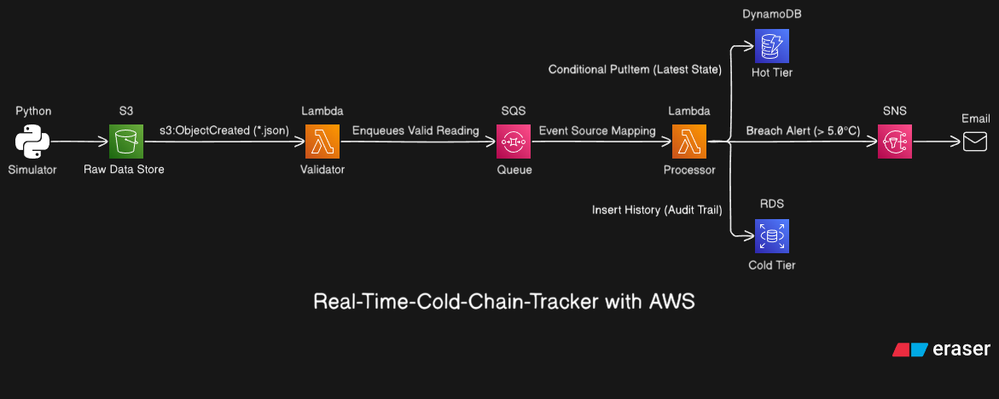

# Real-Time Cold Chain Monitoring & Alerting System

An enterprise-grade, event-driven serverless IoT telemetry pipeline built on AWS and provisioned with Terraform. This system ingests, validates, buffers, and persists real-time refrigerated transport telemetry, automatically detecting critical temperature excursions (> 5°C) and dispatching immediate alerts.

---

## Table of Contents

- [Overview](#overview)
- [Architecture](#architecture)
- [Key Features](#key-features)
- [Component Breakdown](#component-breakdown)
  - [1. Telemetry Ingestion (Amazon S3)](#1-telemetry-ingestion-amazon-s3)
  - [2. Schema & Range Validation (AWS Lambda)](#2-schema--range-validation-aws-lambda)
  - [3. Asynchronous Buffering (Amazon SQS)](#3-asynchronous-buffering-amazon-sqs)
  - [4. Processing & Alerting (AWS Lambda & Amazon SNS)](#4-processing--alerting-aws-lambda--amazon-sns)
  - [5. Dual-Tier Storage (Amazon DynamoDB & AWS RDS PostgreSQL)](#5-dual-tier-storage-amazon-dynamodb--aws-rds-postgresql)
- [Repository Structure](#repository-structure)
- [Data Schema & Validation Rules](#data-schema--validation-rules)
  - [Telemetry JSON Payload](#telemetry-json-payload)
  - [Validation Criteria](#validation-criteria)
  - [DynamoDB Hot Store Schema](#dynamodb-hot-store-schema)
  - [PostgreSQL Cold Store Schema](#postgresql-cold-store-schema)
- [Getting Started](#getting-started)
  - [Prerequisites](#prerequisites)
  - [Infrastructure Provisioning (Terraform)](#infrastructure-provisioning-terraform)
  - [Running the Sensor Simulator](#running-the-sensor-simulator)
- [Monitoring & Verification](#monitoring--verification)
- [Security & IAM Least Privilege](#security--iam-least-privilege)
- [License](#license)

---

## Overview

Perishable commodities (vaccines, pharmaceuticals, biologics, and fresh produce) require continuous refrigeration within strict thermal bounds (typically 2°C to 4°C). Temperature breaches jeopardize product efficacy and regulatory compliance.

The **Real-Time Cold Chain Tracker** solves this challenge with an asynchronous, decoupled, event-driven cloud pipeline:
- **Zero Polling Overhead:** Triggered immediately when telemetry drops into object storage.
- **Resilient Buffering:** Decoupled architecture using message queues prevents downstream throttling under sudden telemetry bursts.
- **Out-of-Order Write Protection:** Utilizes conditional expressions in DynamoDB to ensure stale telemetry cannot overwrite newer readings.
- **Automated Incident Notification:** Immediate alerting via Amazon SNS within seconds of a critical temperature excursion.

---

## Architecture



---

## Key Features

- **Serverless & Scalable:** Zero always-on compute instances for telemetry processing; scales automatically from 0 to thousands of concurrent requests.
- **Schema Validation Gatekeeper:** Strict structural and range check (`-50°C <= temp <= 60°C`) eliminates poisoned or garbage payloads before they hit downstream pipelines.
- **Decoupled Architecture:** Asynchronous message queue buffer (SQS) absorbs ingestion spikes, smoothing traffic for processing workers.
- **Idempotent Hot State Management:** Conditional writes to DynamoDB prevent race conditions and out-of-order telemetry delivery.
- **Automated Anomaly Detection:** Real-time threshold evaluation triggers instant SNS alerts upon temperature violations (`> 5°C`).
- **Infrastructure as Code (IaC):** Fully reproducible infrastructure using modularized Terraform with S3 remote state management and state locking.
- **Built-In Load & Anomaly Simulator:** Realistic Python CLI simulator modeling fleet random-walk temperature variations, intentional anomalies, and corrupt payloads.

---

## Component Breakdown

### 1. Telemetry Ingestion (Amazon S3)
- **Bucket:** `real-time-cold-chain-tracker` (configurable).
- **Prefix Structure:** `incoming/{truck_id}/{timestamp}-{uuid}.json`.
- Configured with `aws_s3_bucket_notification` filtering exclusively for `.json` objects, directly triggering the Validator Lambda function.

### 2. Schema & Range Validation (AWS Lambda)
- **Function:** `real-time-cold-chain-tracker_validator` (Python 3.13).
- **Handler:** `main.handler`.
- **Logic:**
  1. Retrieves object payload from S3.
  2. Asserts `truck_id` is a valid string.
  3. Asserts temperature is within realistic operating ranges: `-50°C <= temperature <= 60°C`.
  4. Confirms non-empty timestamp.
  5. Forwards valid payloads to SQS; discards invalid messages with CloudWatch audit logs.

### 3. Asynchronous Buffering (Amazon SQS)
- **Queue:** `real-time-cold-chain-tracker-sqs`.
- **Retention:** 345,600 seconds (4 days).
- **Visibility Timeout:** 30 seconds.
- Provides peak-shaving and message isolation between validation and persistence layers.

### 4. Processing & Alerting (AWS Lambda & Amazon SNS)
- **Function:** `real-time-cold-chain-tracker_processor` (Python 3.13).
- **Batch Size:** 10 records per execution.
- **Alert Trigger:** Evaluates if `temperature > 5.0°C`.
- **Notification Target:** `real-time-cold-chain-tracker-sns` publishing to configured email endpoints.

### 5. Dual-Tier Storage (Amazon DynamoDB & AWS RDS PostgreSQL)
- **Hot Tier (DynamoDB):**
  - Table: `real-time-cold-chain-tracker-table`
  - Billing Mode: `PAY_PER_REQUEST` (On-Demand).
  - Partition Key: `truck_id` (String), Sort Key: `timestamp` (String).
  - Maintains latest active thermal state per transport unit.
- **Cold Tier (RDS PostgreSQL):**
  - Engine: PostgreSQL 16 on `db.t4g.micro`.
  - Schema defined in `temperature_history.sql` for historical trend analysis, compliance reports, and audit trails.

---

## Repository Structure

```
Real-Time-Cold-Chain-Tracker/
├── Simulate-Sensors/              # IoT fleet telemetry simulation tool
│   ├── main.py                    # Multi-truck simulator CLI with anomaly generation
│   └── requirements.txt           # Simulator dependencies (boto3)
├── lambda/
│   ├── Validator/                 # Ingestion & validation Lambda
│   │   ├── main.py                # S3 event parsing & SQS forwarding
│   │   └── function.zip           # Packaged Lambda archive
│   └── Processor/                 # Queue consumer & alerting Lambda
│       ├── main.py                # DynamoDB conditional writes & SNS publishing
│       ├── requirements.txt       # Dependencies (psycopg[binary])
│       └── package/               # Pre-compiled cross-platform dependency bundle
├── Terraform/                     # Infrastructure as Code root
│   ├── backend.tf                 # S3 remote state and lockfile configuration
│   ├── main.tf                    # Root composition linking all modules
│   ├── provider.tf                # AWS provider configuration
│   ├── variables.tf               # Global deployment input variables
│   └── modules/                   # Reusable infrastructure modules
│       ├── database/              # RDS PostgreSQL instance
│       ├── dynamodb/              # DynamoDB telemetry table
│       ├── lambda-processor/      # Processor Lambda, IAM policies, and event source mapping
│       ├── lambda-validator/      # Validator Lambda, IAM policies, and S3 permissions
│       ├── s3_bucket/             # S3 ingestion bucket and notification hooks
│       ├── sns/                   # SNS topic and email subscription
│       └── sqs/                   # SQS buffering queue and queue access policies
├── temperature_history.sql        # Relational SQL schema for cold storage historical audits
└── README.md                      # Project documentation and architecture guide
```

---

## Data Schema & Validation Rules

### Telemetry JSON Payload

Sensors deliver single-reading JSON payloads with the following structure:

```json
{
  "truck_id": "T-102",
  "temperature": 3.42,
  "timestamp": "2026-11-09T07:35:00Z"
}
```

### Validation Criteria

The Validator Lambda applies strict assertions before enqueuing records:

| Field | Type | Validation Constraint | Action on Failure |
| :--- | :--- | :--- | :--- |
| `truck_id` | String | Must be non-empty string | Discard & log rejection |
| `temperature` | Float / Number | Must satisfy `-50.0 <= temp <= 60.0` | Discard & log rejection |
| `timestamp` | String | Must be non-empty ISO 8601 string | Discard & log rejection |
| JSON format | String | Must be valid syntactical JSON | Discard & log rejection |

### DynamoDB Hot Store Schema

- **Table Name:** `real-time-cold-chain-tracker-table`
- **Partition Key (HASH):** `truck_id` (String)
- **Sort Key (RANGE):** `timestamp` (String)
- **Conditional Expression:**
  ```python
  ConditionExpression="attribute_not_exists(truck_id) OR #t < :ts"
  ExpressionAttributeNames={"#t": "timestamp"}
  ExpressionAttributeValues={":ts": ts}
  ```

### PostgreSQL Cold Store Schema

Defined in [`temperature_history.sql`](temperature_history.sql):

```sql
CREATE TABLE IF NOT EXISTS temperature_history (
    id BIGINT GENERATED ALWAYS AS IDENTITY PRIMARY KEY,
    truck_id VARCHAR(50) NOT NULL,
    temperature DECIMAL(5,2) NOT NULL,
    location VARCHAR(100),
    humidity DECIMAL(5,2),
    recorded_at TIMESTAMPTZ NOT NULL,

    CONSTRAINT uq_truck_recorded_at UNIQUE (truck_id, recorded_at)
);

CREATE INDEX IF NOT EXISTS idx_truck_time ON temperature_history (truck_id, recorded_at);
```

---

## Getting Started

### Prerequisites

- **AWS Account** with administrative permissions.
- **AWS CLI** configured (`aws configure`).
- **Terraform** >= 1.5.0 installed.
- **Python** 3.11+ (Python 3.13 recommended for Lambda parity).

---

### Infrastructure Provisioning (Terraform)

1. **Clone the repository:**
   ```bash
   git clone https://github.com/your-username/Real-Time-Cold-Chain-Tracker.git
   cd Real-Time-Cold-Chain-Tracker/Terraform
   ```

2. **Configure your remote backend:**
   Update `backend.tf` with your specific S3 bucket name, region, and profile:
   ```hcl
   terraform {
     backend "s3" {
       bucket       = "your-terraform-state-bucket"
       key          = "real-time-cold-chain-tracker/terraform.tfstate"
       region       = "us-east-1"
       encrypt      = true
       use_lockfile = true
     }
   }
   ```

3. **Initialize Terraform:**
   ```bash
   terraform init
   ```

4. **Review execution plan:**
   ```bash
   terraform plan
   ```

5. **Deploy the infrastructure:**
   ```bash
   terraform apply
   ```

6. **Confirm SNS Subscription:**
   Check the inbox of the email configured in `Terraform/modules/sns/main.tf` and click **"Confirm subscription"** to receive temperature breach notifications.

---

### Running the Sensor Simulator

The simulator models real-world IoT telemetry, normal operating fluctuations, randomized critical temperature spikes, and network/sensor corruption.

1. **Navigate to the simulator directory and install dependencies:**
   ```bash
   cd ../Simulate-Sensors
   python3 -m venv venv
   source venv/bin/activate
   pip install -r requirements.txt
   ```

2. **Dry Run (Local verification without S3 upload):**
   ```bash
   python main.py --bucket real-time-cold-chain-tracker --dry-run
   ```
   *Files will be output locally to `./sample_logs`.*

3. **Live Fleet Simulation (Stream to S3):**
   ```bash
   python main.py \
     --bucket real-time-cold-chain-tracker \
     --trucks 5 \
     --rounds 20 \
     --interval 1.5 \
     --alert-rate 0.15 \
     --bad-rate 0.05
   ```

#### Simulator CLI Arguments:

| Argument | Type | Default | Description |
| :--- | :--- | :--- | :--- |
| `--bucket` | string | *Required* | Target AWS S3 bucket name |
| `--prefix` | string | `incoming/` | S3 object key prefix |
| `--trucks` | int | `3` | Number of trucks simulated concurrently |
| `--rounds` | int | `10` | Reading rounds generated per truck |
| `--interval` | float | `1.0` | Delay in seconds between rounds |
| `--alert-rate`| float | `0.10` | Probability (0.0 - 1.0) of generating a reading > 5°C |
| `--bad-rate` | float | `0.05` | Probability (0.0 - 1.0) of generating malformed data |
| `--dry-run` | flag | `false` | Writes logs to `./sample_logs` rather than S3 |
| `--seed` | int | `None` | Random seed for deterministic reproducibility |

---

## Monitoring & Verification

1. **CloudWatch Logs:**
   - Validator: `/aws/lambda/real-time-cold-chain-tracker_validator`
   - Processor: `/aws/lambda/real-time-cold-chain-tracker_processor`

   View live streaming logs:
   ```bash
   aws logs tail /aws/lambda/real-time-cold-chain-tracker_validator --follow
   aws logs tail /aws/lambda/real-time-cold-chain-tracker_processor --follow
   ```

2. **Inspect Hot State in DynamoDB:**
   ```bash
   aws dynamodb scan --table-name real-time-cold-chain-tracker-table --max-items 5
   ```

3. **Verify SQS Queue Metrics:**
   ```bash
   aws sqs get-queue-attributes \
     --queue-url $(terraform -chdir=Terraform output -raw sqs_queue_url) \
     --attribute-names ApproximateNumberOfMessages ApproximateNumberOfMessagesNotVisible
   ```

4. **Alert Notification Sample:**
   When a reading exceeds 5.0°C, the operator receives an email alert:
   ```text
   Subject: Temp alert: T-103
   Body: T-103 reported 6.84°C at 2026-11-09T07:42:15Z (limit 5°C)
   ```

---

## Security & IAM Least Privilege

The infrastructure strictly adheres to the principle of least privilege:
- **Validator IAM Role:** Granted read-only permission (`s3:GetObject`) scoped specifically to `${var.s3_bucket_arn}/*`, and write permission (`sqs:SendMessage`, `sqs:SendMessageBatch`) restricted to the SQS queue ARN.
- **Processor IAM Role:** Granted read permission for SQS messages (`AWSLambdaSQSQueueExecutionRole`), write permission (`dynamodb:PutItem`) restricted to the DynamoDB table ARN, and publish rights (`sns:Publish`) scoped to the alert SNS Topic.
- **SQS Resource Policy:** Explicitly restricts message dispatching to the Validator Lambda using `aws:SourceArn` condition checks.

---

## License

This project is licensed under the MIT License - see the LICENSE file for details.
